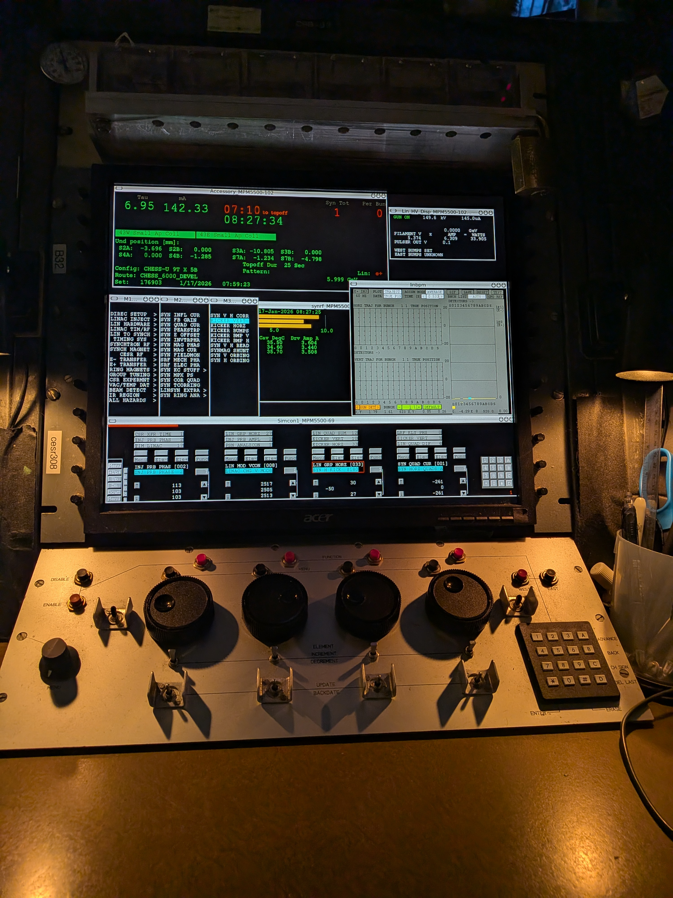
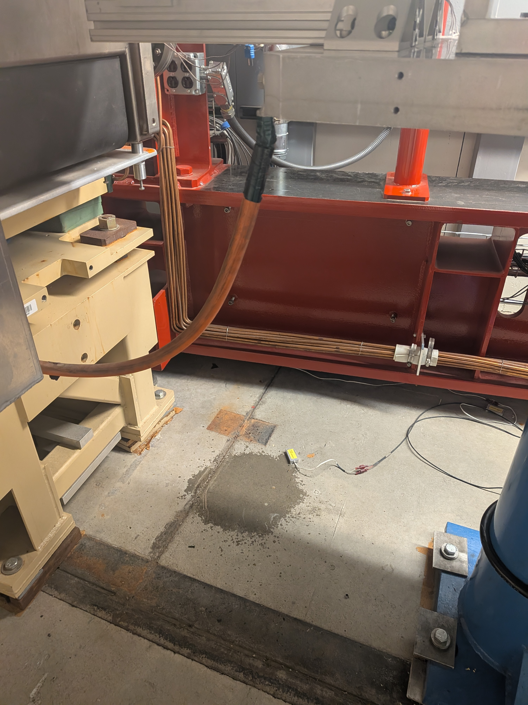

+++
title = "Day in the Life of a Particle Accelerator Operator "
date = 2026-02-05
draft =  true
summary =  "Written for the inevitable follow up question."

+++

## A (fictionalized) day in the control room {#heading-1}

The CESR control room is the heartbeat of the 768m synchrotron particle accelerator below Cornell’s athletic track. Its simple function: accelerate positrons to 99% the speed of light so as to produce x-ray light for scientists to study various materials and structures. But, boy does it need a lot of help to do this. The beam is shy, so vacuum systems remove any other atoms in the beam pipe. Water systems help cool off the electromagnets that work hard to steer particles round and round. And all these systems and more need to communicate their status regularly and fast via hardware and software. Luckily. there is a central place and person where you can get information about the machine and the systems that support, any time, any day, even on Christmas. A particle accelerator operator staffs the CESR control room 24/7. They do a range of tasks from securing the tunnel before turn om to inspections and dealing with alarms. It’s a challenge to describe the breadth of tasks an operator does so I thought to give an example of day. In this account, we spend 8 hours in the CESR control room. I try to explain the accelerator lingo as I go in purple callout boxes.

First thing I do is grab my dosimeter.

The owl operator ( whose shift started  last night) details the issues of last night. A synchrotron radio frequency cavity tripped during topoff a few times. She lowered the cavity voltage a bit to remedy it as is standard. I then check the lab internal electronic log for myself for ongoing work updates. I see the control system group updated a program that was glitching. As an operator I should generally be knowledgeable of the status of various subsystems and create updates when appropriate.

As an operator, I am quite sensitive to the lights and sounds of the control room. When I know longer hear the large electrical hum that often blends into the background, then I know the linac as tripped off. I check the relevant panel. Its seems to be nothing more than an electrical blip so I reset the safety ready chain (a serious of cinditions that have to be met before a piece of equipment is ready to turn on) and turn on the decades old 20 MeV linear accelerator again with the push of a few buttons.

. That is the energy of one electron experiencing an equivalent of 6 billion volts! Although we have a lot of high voltage equipment at the lab, the magnets are not running at 6GV. Rather, the particles must "ride the wave" around and around 20 times, gaining more energy each time, to reach that energy.")

Things were relatively quiet until half past noon. A persistent robotic beep in the control room alerted h to an issue with the gun. It had tripped off and refused to come on again. The gun is the source of the electrons (later converted to positrons) for the whole machine. If it doesn’t work, no new electrons can be created, converted to positrons , accelerated and added to the storage ring .I called the relevant personnel who requests that I prepare for an “access”. This is a routine procedure operators perform to allow our operations people to get into the tunnel to perform repairs. I coordinate an access to the linac section of the machine and communicate updates to the necessary people and later to the lab in general vial electronic log.

Shift handover complete. The system director tells me that the electron gun problems have all been resolved. I sign in at the computer and review the electronic logs of the day.

A day like this would be considered relatively eventful. The best days for the lab are uneventful for us operators. The lab staff do their best not to have interruptions to operations through careful planning, having designated maintenance days and good communication between operators and other operations staff. But sometimes things happen and when they do a CESR operator is always there. (Cue the song)
